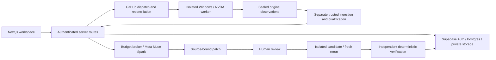

# Tabwise

**Accessibility regression testing and repair review for keyboard journeys, grounded in screen-reader observations.**

Built by **Works on My Machine** — Aniruddh Vijayvargia and Prachi Agarwalla.

*“We finally tested it on yours, too.”*

Tabwise connects a saved keyboard journey to evidence, diagnosis, a reviewable
source patch and a separate verification result. It focuses on forms and dialogs:
what receives focus, what the screen reader says, and whether a proposed repair
preserves the intended journey.

## Current availability

**Development integration; production qualification is incomplete.** The public
demo, owned synthetic application, browser-local journey editor, historical R1
trace and report can be explored without credentials. Authenticated persistence,
repair review and orchestration have server implementations and deterministic
tests. They require the dedicated backend and appropriate permissions.

A genuine **product-owned nonproduction candidate flow has completed**: saved
Fernway seat journey, NVDA baseline, real Meta diagnosis, exact human-approved
patch, fresh native rerun, private original-archive readback and a deterministic
**FIXED** engineering report. Final runs41895961948/2 and41897432880/2 both passed
Windows native capture and a separate Linux verifier. Each retained25 observations.
The comparison restored focus from body to the seat button while preserving the
protected steps' observed focus and speech. Evidence class **MACHINE/L3**;
model suggestion **MODEL/L1**.

Original raw manifests retain their synthetic class; the separate candidate
wrapper is **NONPRODUCTION / UNQUALIFIED**. Nothing is promoted into production
qualification. External independent qualification authority is unavailable, and
R2, R3 and R7 are not declared complete against their full registered criteria.
Native dispatch/authorization/import used the trusted operator adapter over the
shipped candidate contracts; fully automatic browser dispatch is unfinished.

The public UI is at [Tabwise](https://tabwise-meta.vercel.app/). The completed
owner-only flow and exact evidence links are in the
[demo instructions](docs/engineering/Tabwise-demo-readiness-20261104.md) and
[byte-indexed evidence](docs/evidence/candidate-complete-20261104/index.json).
PR26 and [PR27](https://github.com/ANIRUDDH-001/Tabwise/pull/27) are merged.
The deployment dependency correction and isolated-package regression are in
[PR28](https://github.com/ANIRUDDH-001/Tabwise/pull/28). See the
[current state](docs/ledger/STATE.md) and `/status` for explicit limits.

### Record the measured flow

Sign in with the existing project owner account and open the
[genuine baseline](https://tabwise-meta.vercel.app/candidate-runs/e2bf14b6-55c0-4653-af87-3a3ba2d9abe5).
Show the observed speech/focus and approved patch, then choose **Open approved
repair rerun** to reach the
[repaired capture and FIXED report](https://tabwise-meta.vercel.app/candidate-runs/8b77652c-bee8-45d2-b72d-2d40cb960a73).
These are private owner records. Use the completed captures for recording;
reopening the approved repair recovers the same run instead of allocating another.

One actual Muse Spark1.3 call used **$0.01522975 promotional credit, ₹0 paid**.
No fresh model or native execution is needed to inspect this recorded flow.
The full sources, hashes, cost excerpt and qualification limits are in the
[submission evidence index](docs/evidence/candidate-complete-20261104/index.json).

## Capabilities

- Record, reorder and save supported keyboard journeys locally; save immutable
  account versions when authentication/backend configuration is available.
- Inspect speech, focus, key and page-event timelines with evidence references.
- Prepare owned native requests and track their server-authorized states.
- Generate structured evidence-grounded diagnosis and bounded source patches
  through the model broker when inference is legitimately enabled.
- Approve or reject an exact patch; materialize a separate immutable candidate
  with stale-source, ownership and concurrency checks.
- Compare a baseline and rerun through a separately registered deterministic
  oracle. Missing or unqualified evidence must remain inconclusive.
- Retain owned reports and regression history through the persistence layer.

The measured candidate flow above exercises these boundaries. General production
qualification and fully automatic browser dispatch remain gated.

## Architecture



The diagram describes the integrated boundaries. The nonproduction candidate flow
has measured native export/readback and repair/rerun; production qualification
and general automatic dispatch remain gated.

| Location | Responsibility |
| --- | --- |
| `web/` | React/Next.js application, OAuth, owned APIs and UI |
| `packages/contracts/` | Run, evidence, patch and product artifact contracts |
| `src/r2/`, `scripts/tabwise/r2-*` | Native capture, source/admission boundaries, evidence and product adapters |
| `src/repair/` | Exact patch application, candidate identity, rerun/oracle logic |
| `src/meta/`, `src/budget/` | Structured model calls, reservations, replay and accounting |
| `supabase/migrations/`, `supabase/tests/` | Versioned persistence/RLS and SQL regressions |
| `fixtures/` | Owned synthetic Fernway and R1/R2 pages and journeys |
| `vendor/` | Frozen, attributed Guidepup R1 closure |
| `diagnostics/`, `.github/workflows/` | Source-bound isolated Windows diagnostics and workflows |
| `test/`, `web/test/` | Contract, component, integration and browser checks |
| `docs/evidence/`, `docs/ledger/` | Original evidence, decisions, costs, plan and provenance |

The stack is Node.js, React, Next.js, TypeScript, Supabase, PostgreSQL, Playwright,
axe-core, Guidepup, NVDA and Meta Muse Spark. Exact versions are in the lockfiles;
use the checked-in versions rather than upgrading during reproduction.

## Start the local demo

Prerequisites: Git, Node.js **24.22.1** (the tested CI version), npm, and a browser.
The demo does not require Supabase, OAuth, an API key or a Windows screen reader.
These are setup commands for a new checkout; they do not start native execution.

```powershell
git clone https://github.com/ANIRUDDH-001/Tabwise.git
cd Tabwise
git switch feat/tabwise-r2-r7-product-completion
npm ci --ignore-scripts
npm --prefix web ci --ignore-scripts
npm --prefix packages/contracts ci --ignore-scripts
npm --prefix web run dev
```

Open `http://127.0.0.1:3000/w/demo`. Choose Fernway, open a supported journey,
record or edit its steps, and save a browser-local version. Browser-local storage
is specific to that origin and browser; it is not an account backup. Account save
and new native execution can report unavailable/gated states in this setup.

To check a production build locally:

```powershell
npm --prefix web run build
npm --prefix web run start
```

## Environment and authenticated workspace

Copy `web/.env.example` to `web/.env.local` only when configuring the backend.
The root `.env.example` describes model credentials for the separate project
client. Real values belong only in ignored local files or server secrets.

| Variable | Purpose |
| --- | --- |
| `NEXT_PUBLIC_SUPABASE_URL` | Public backend URL; checked against the dedicated project allowlist |
| `NEXT_PUBLIC_SUPABASE_PUBLISHABLE_KEY` | Public RLS-bound key; inlined at build time |
| `SUPABASE_SERVICE_ROLE_KEY` | Secret server-only database/storage access; never a public variable |
| `TABWISE_OAUTH_CONFIGURED` | Leave unset until the GitHub provider and redirects are configured |
| `GH_PAT`, `GH_PAT_OWNER` | Privileged server worker integration; omit for ordinary demo/Preview |
| `MODEL_API_KEY` | Secret Meta credential; availability does not authorize spending |
| `BUDGET_CAP_USD` | Optional lower local monetary ceiling |
| `TABWISE_EXECUTION_APPROVAL_REF`, `TABWISE_META_APPROVAL_REF` | Recorded approvals; arbitrary strings do not replace database/source gates |
| `TABWISE_R2_RECEIPT_PRIVATE_KEY` | Existing authority's server-only W5 receipt key; never generate a self-trusted production authority |

Deployment revision variables are supplied by Vercel/GitHub. Native request
preparation can use `TABWISE_NATIVE_CANDIDATE_REVISION` locally. Review the actual
server policy modules before enabling privileged paths; this table is not a
complete native workflow activation procedure.

The shipped server pins Supabase project `ueobjrtvsgvkigmjxkks`, as recorded in
`supabase/tabwise-project.json` and `web/lib/server/core.mjs`. An unrelated URL is
refused. A fork needs an explicit review of this allowlist, policies, identity
bindings and fixtures before using its own backend. A public clone does not grant
access to the team's backend or permission to change its policy.

For GitHub sign-in, configure a GitHub OAuth application and enable the GitHub
provider in Supabase. The provider callback is the Supabase project's
`/auth/v1/callback`; the application's callback is `/auth/callback` on its actual
origin. Add the latter to Supabase's redirect allowlist and configure the site
origin. Do not put the OAuth client secret into the browser environment. The
application exchanges the authorization code server-side and redirects to
`/w/me`. Use the exact localhost/127.0.0.1 origin you configured.
[Supabase provider instructions](https://supabase.com/docs/guides/auth/social-login/auth-github)
and [redirect configuration](https://supabase.com/docs/guides/auth/redirect-urls)
describe these distinct callbacks. Real hosted OAuth acceptance is still pending.

## Database setup and migrations

Database changes are an operator task. Use a dedicated Supabase environment with
Auth and Storage schemas; the product migrations are not a standalone installer
for an empty PostgreSQL server. There is no checked-in local `supabase/config.toml`.
Do not assume `supabase start` alone configures this application.

Review the SQL in `supabase/migrations/` and apply pending files in filename order
through your approved migration process, preserving migration history. Review
the target project and existing history first. `supabase/seed-fernway.sql` is the
separate owned-app seed; applying schema does not authorize execution, register an
operator, configure OAuth or enable model calls. SQL under `supabase/proposals/`
is not automatically applied and must not be treated as a production migration.

For a separately initialized CLI environment, Supabase's `db push --dry-run`
shows a migration plan without applying it. Check the installed CLI's target
flags and linked project before any actual push. See the
[migration guide](https://supabase.com/docs/guides/local-development/database-migrations).
Do not reset a hosted database to reproduce tests.

The optional database tests target disposable loopback PostgreSQL databases and
have explicit opt-ins in each `*database.test.mjs`. They are skipped by ordinary
root/web runs. Read their fixed database/role/port settings and SQL fixtures before
enabling them; never point them at customer or production data. Migrations/RLS
and SQL integration results are documented in the source-bound review package.

## Tests and development commands

```powershell
npm test
npm --prefix web test
npm --prefix packages/contracts test
npm --prefix web run typecheck
npm --prefix web run build
node web/test/product-trace.check.mjs
node scripts/check-r1-baseline.mjs
node scripts/preflight.mjs --clean
npm run versions
npm run spend
```

Use `node --test test/<name>.test.mjs` for a focused root test. The packaging check
needs a completed web build. A clean preflight requires committed source.
`npm run spend` opens the local accounting store; it is not a billing-provider
reconciliation. Do not create a new accounting store to reset a campaign limit.

Browser checks are explicit files ending in `.browser.mjs`, outside ordinary web
unit selection. For example, with the local production server running on port 3137,
`node --test web/test/native-controls.browser.mjs web/test/repair-oracle.browser.mjs`
exercises controlled local UI/API scenarios.
Inspect each file's server/fixture requirements first. Browser fixtures and mocked
sessions are not evidence of hosted OAuth or genuine NVDA acceptance.

Offline CI runs only the classified subset in `ci/offline-tests.json`, including
reordering and fault profiles. It intentionally excludes native input, model calls
and optional databases. Green offline CI does not establish native qualification.

## Windows/NVDA and native admission

Genuine screen-reader/input execution is restricted to the isolated hosted Windows
worker and owned fixture pages. Do not launch NVDA/Guidepup automation on a
development desktop using this repository's workflows or helpers.

The Windows workflows pin the image, Node, actions, runtime source and owned
fixture hashes. Guidepup setup, NVDA and Chromium are installed inside the
disposable runner. Native admission additionally requires the exact source
revision, reviewer/owner decision, initial GitHub run/attempt, approved plan,
actor, runtime pins and existing W5 permanent consumption/process grant.
The committed policies ship disabled/BLOCK. Editing a UI flag, setting an
environment variable, replaying an OIDC token or downloading a diagnostic ZIP
does not provide these authorities. The product workflow proposal under
`docs/engineering/` is not an activated production workflow.

The new product plan issuer uses the existing W5 receipt key and an authenticated
durable `RUN_BOUND` association. It does not consume again or mint input authority.
The fresh producer lifecycle requires committed source authority, the actual
private runtime brand and process-bound grant; it cannot import an old archive as
a fresh capture. It surrounds the existing single native-session entry. The
coordinator signs a separate origin envelope; the exporter requires original raw
capture pointers and keeps raw manifest classes unchanged. These contracts have
only deterministic fixture validation. Fresh credential provisioning and actual
native/export/readback acceptance remain unfinished. Independent qualification
is separate.

Supported journeys use the owned Fernway passenger, seat and search pages. Only
the registered keyboard press palette, bounded journey sizes and approved fixture
queries are supported. Arbitrary URLs, external websites, unrestricted typing and
arbitrary filesystem patches are not supported execution targets.

## Diagnosis, patch review and verification

An eligible run supplies bounded, source-bound evidence to the Meta Muse Spark
pipeline. The broker reserves capacity before transport; output must satisfy the
structured contract. Diagnosis cites evidence. A patch names the exact original
source hash, allowlisted file/lines, intended changes and reproducible patch hash.

The signed-in owner reviews the diff and explicitly approves or rejects that
exact patch. Approval is distinct from application. Application creates a separate
source candidate, checks the expected version and preserves the original. A
rerun must collect fresh evidence from that candidate. The verifier compares
source/run/patch identities and the previously registered expected behavior.

`FIXED`, `NOT_FIXED`, `REGRESSED` and `INCONCLUSIVE` require their corresponding
supported observations. A model prediction, successful API response or incomplete
rerun is not a verified repair. Current oracle coverage is deliberately narrow;
unsupported checks abstain. Genuine baseline/repaired rerun and independent R7
assessment are still pending. Reports and regression retention must preserve these
uncertainties and original evidence references.

## Model budget and execution safety

All model calls go through `src/meta/` and the budget broker. During this campaign,
the ceiling is **20 external requests**, including failed/uncertain requests and
retries, with **₹0 incremental paid spend**. Eligible promotional/free credit must
be confirmed before the first call. Do not infer authorization from an API key.

The local broker persists request reservations in SQLite and the append-only cost
ledger and refuses to replace or raise an established campaign limit. This is a
local campaign ceiling, not a claim of a distributed hosted request counter.
Hosted monetary reservations use separate database transactions. Monetary caps
do not establish available credit. Uncertain requests retain reservations. Use
the replay cache for unchanged development inputs and reconcile provider billing
before enabling live calls. See [the ledger rules](AGENTS.md) and
[budget implementation](src/budget/broker.mjs).

Ownership, same-origin checks, RLS, private storage, exact source/artifact identity,
replay protection, reconciliation leases and atomic patch decisions remain server
responsibilities. Preview deployments refuse execution side effects even when
credentials exist. Browser code must never receive service-role, signing, OAuth
client or model secrets. Uploaded files and model output are untrusted data.

## Evidence and reports

Original native page journals carry lane hashes, manifests, step/session identity,
capture records and runtime observations. Product artifacts bind the run spec,
source, original archive, GitHub workflow/run/attempt and separate attestation.
Reports retain evidence references and uncertainty rather than replacing raw
observations with model prose. See [product contracts](packages/contracts/r2-product.mjs)
and [archived review evidence](docs/evidence/product-completion-20261104/).

Checksums establish byte integrity; they are not independent accessibility
qualification. Historical evidence is immutable. The legacy raw writer's class
is preserved even when a new fresh-capture producer describes actual observed
runtime behavior separately. No producer can independently certify its own run.

## Deployment

The Next.js application lives in `web/`. Vercel builds use that root and
`web/next.config.mjs`; tracing includes the raw reviewed native/repair sources
needed by server integrity checks. Keep `web/r2-trace-files.json` consistent with
`R2_FILES`, then run the production build and route trace check.

Configure public build-time and secret server variables in their appropriate
environment scopes. Controlled Preview deployment is not production activation:
keep Preview protections and execution refusals enabled. OAuth redirects need the
actual deployment origin. Do not alias a development deployment to production or
enable native/model policies as part of an ordinary build. Deployment protection
can prevent automated hosted acceptance; do not report local checks as a bypass.

## Troubleshooting

| Symptom | Check |
| --- | --- |
| Demo works but account save fails | Backend environment, dedicated project pin, OAuth and actual session |
| Sign-in unavailable | GitHub provider, both callback types and the server OAuth configuration flag |
| Wrong Supabase project | Expected refusal; review fork configuration instead of disabling ownership/RLS |
| Native button absent or action refused | Server capabilities, stored state, committed authority and Preview boundary |
| Run ends without complete evidence | Original artifact, worker association, ingestion/deadline/cancellation state; never mark it completed manually |
| Source/digest/pin refusal | Exact checkout and reviewed source scope; do not update pins merely to hide an unexplained change |
| Diagnosis/model call refused | Evidence eligibility, confirmed credit, reservation ceiling and review flags |
| Verification inconclusive | Missing/partial/unqualified observations, unsupported oracle or mismatched source/run/patch |
| Optional tests skipped | Explicit disposable-database setup is required; ordinary unit CI does not supply it |
| Packaged route lacks a file | Trace inventory/configuration and a fresh production build |

## Contributing and licensing

Read [AGENTS.md](AGENTS.md), [the code map](docs/CODEMAP.md) and the relevant
ledger/task entry. Make scoped changes on a development branch, preserve frozen
R1/vendor sources and original evidence, write contract/parser/verifier tests
first, and disclose measured versus synthetic validation. Keep secrets, generated
caches and local environment files out of Git. New dependencies/fixtures need
license and provenance records. Do not weaken tests or qualification gates to
produce a green status. Integration and production activation require review.

Original Tabwise material is [MIT licensed](LICENSE). Third-party code, NVDA,
browser/runtime assets and vendored sources retain their own terms; see
[THIRD_PARTY_NOTICES.md](THIRD_PARTY_NOTICES.md) and
[PROVENANCE.md](docs/ledger/PROVENANCE.md).

Project: [GitHub repository](https://github.com/ANIRUDDH-001/Tabwise) ·
[Issues](https://github.com/ANIRUDDH-001/Tabwise/issues) ·
[CI runs](https://github.com/ANIRUDDH-001/Tabwise/actions) ·
[Integration review](https://github.com/ANIRUDDH-001/Tabwise/pull/26).
