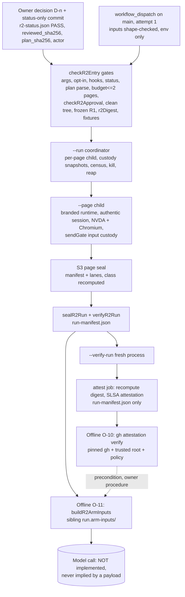

# R2 final engineering handoff (D-89)

Written 2026-10-31 (UTC) by Claude at the end of the final autonomous engineering pass. Branch `feat/tabwise-r2-final-handoff`, worktree `D:\Projects\Meta AI\app-r2-final-handoff`, based on `origin/main` = `71228ae2af198a4f0dcdb47e7cb68c5f5d165c82`. **Nothing here is committed or pushed by Claude.** After the owner merges this branch, R2 work belongs to the successor team.

Labels follow AGENTS.md: **MEASURED** (a command run in this session, output under the ignored `cache/`), **CITED** (a committed document or commit), **INFERENCE** (reasoning, not run).

---

## A. Executive status

**What Tabwise does.** Tabwise tests web forms and dialogs for accessibility regressions from real screen-reader speech. It drives a page with keyboard input, records what NVDA says, and compares a healthy page with a broken one (`docs/ledger/PLAN.md` F-03; `fixtures/r2/manifest.json`).

**What R2 is meant to show.** R2 is a causal smoke test. On a disposable GitHub-hosted Windows VM, one approved run plan drives each page with approved key presses. For each page it:
- captures NVDA speech and page events;
- seals per-page evidence and a run manifest;
- re-verifies the run from disk;
- attests the run manifest with a SLSA provenance attestation.

From that sealed evidence, the speech-arm model input is derived offline under custody (O-11). R2 is not a qualification of NVDA, of the runtime or of the physical input (S7 handoff §1; workflow header).

| Area | State |
|---|---|
| S1–S6, S5a/S5b, C-1, C-3, O-10, O-12, S7, R-1/R-2 custody | Implemented and merged (PRs below). Offline-tested |
| **O-11 arm-input custody** | **Implemented in this pass** (`src/r2/arm-inputs.mjs`). Offline-tested and mutation-tested |
| **A-5 run plan** | **Candidate committed in this pass** (`fixtures/r2/plans/a5-validation-smoke.json`). **Not approved** |
| R2 activation | **BLOCKED.** `scripts/tabwise/r2-status.json` is `enabled:false`, `verdict:"BLOCK"`, byte-identical to `origin/main` (MEASURED) |
| Authentic hosted run, NVDA speech, attestation verification | **Never executed.** No genuine R2 evidence exists |

**Why offline green is not qualification.** Every R2 test runs on synthetic sealed evidence, fake process tables or injected seams. The S3 verifier cannot assign the class `genuine-unqualified` without an authentic runtime attestation (`ATTESTATION_UNAVAILABLE`, `scripts/tabwise/r2-evidence.mjs:32`). So the production arm-input path refuses every page today. That refusal is the correct output, not a gap in the tests. Several things have never run, and no offline test can show them:
- the hosted `windows-2025` image;
- pwsh 7;
- NVDA;
- real process termination;
- the 40-minute budget;
- Sigstore verification.

---

## B. Engineering provenance

### B.1 Merged history (CITED, `git log --merges origin/main`)

| PR | Merge | Content |
|---|---|---|
| #6 | `46749e0` | R2 post-final-stop fix |
| #3 | `78cf379` | M2B/M2C review |
| #7 | `eedfdcb` | R2 post-merge chores |
| #8 | `a8232fe` | R2-L1 page journal |
| #9 | `45bcd80` | R2-L2 boundaries design |
| #10 | `9174467` | S1/S2 offline |
| #11 | `015128b` | S3 evidence offline |
| #13 | `3388107` | S5b/S6 authentic session and gated entry |
| #14 | `adf6f10` | O-12 `nonce-redact/2` and O-10 offline provenance verifier |
| #16 | `30ad3b1` | R-1/R-2 Windows process custody |
| #15 | `71228ae` | S7 verify-run, workflow and attestation, plus the custody integration (D-88) |

### B.2 This pass (D-89; owner-authorized in the task message, recorded in `docs/ledger/DECISIONS.md`)

**New files:**

| File | Purpose |
|---|---|
| `src/r2/arm-inputs.mjs` | O-11 builder and verifier |
| `fixtures/r2/plans/a5-validation-smoke.json` | A-5 candidate plan |
| `fixtures/r2/plans/validation/healthy.html`, `broken.html` | Byte-identical copies of the registered development fixtures |
| `fixtures/r2/plans/README.md` | Plan directory rules and candidate status |
| `docs/engineering/R2-final-handoff.md` | This file |
| `docs/engineering/R2-owner-publication-checklist.md` | Owner publication steps |

**Modified files:**

| File | Change |
|---|---|
| `scripts/tabwise/r2-policy.mjs` | `R2_FILES` gains `src/r2/arm-inputs.mjs` (18 → 19), plus one comment line |
| `test/r2-evidence.test.mjs` | +10 tests, O11-P1..S1 |
| `test/r2-review.test.mjs` | +3 tests, A5-P1, A5-N1, A5-N2. The pinned S7-I1 list gains `src/r2/arm-inputs.mjs` (disclosed; the only edit to an existing test) |
| `docs/CODEMAP.md`, `docs/ledger/{DECISIONS,PLAN,STATE}.md`, `docs/ledger/LOG.jsonl` | Ledger and code map |

**Not changed (MEASURED, `git diff --quiet origin/main`):**
- `.github/`;
- `scripts/tabwise/{r2,qualification,review}-status.json`;
- `package.json`, `package-lock.json`;
- `vendor/`;
- every other R2 source file.

### B.3 Digests (MEASURED; recompute and never copy at activation)

| Item | Value |
|---|---|
| `r2Digest()`, 19 `R2_FILES`, CRLF-normalized | `5e38d6b0dd2d40e9b882b00c7483093d25e978dc296d879326db423a711640e3` |
| Previous `r2Digest` (18 files, D-88, CITED) | `bc468ed1119fa796c52468f3db51cc0a3f7031702e394dec0244dd5b57752ed7` |
| `qualificationDigest()` | `6972c311a6e9302856ff9bb9195aa73cf106a15da8caf91ac32b781f8909f328` |
| `r2PlanDigest(a5-validation-smoke.json)` = sha256 of the LF file bytes | `8bb82898703fbaf4d8a4f70fd2223b02913a2c5f0cbbd85d7a17fedb251bc0b4` (1101 bytes) |
| `fixture_sha256` validation-healthy / broken (`pageHash`) | `f22a2f22be578e0609f990564acb703bab40bd8bf770079acc090775d79e9555` / `4d1d06db6d4b88401042ae32d5c48361d90d5845c528a8777e8eee998d4c5f2a` |
| `package-lock.json` / `package.json` (unchanged) | `2306bb99ff313aecee64e63117534cb084b26262b3c58c41ad7db0175f7fb820` / `52ce4c020bfa6cd23ec16db1a8795646707ef391953d03ffbbb5f6fc1be22065` |
| Frozen R1 baseline (`check-r1-baseline`) | `ok:true`, revision `0c93fa73e0c111a2df65302adfe0006d63f50a39` |

On a Windows checkout with `core.autocrlf=true`, the working-copy plan file is CRLF. Its raw sha256 then differs from the value above. `r2PlanDigest` normalizes CRLF and is the binding identity used by `checkR2Approval` and the workflow input `plan_sha256`.

### B.4 Environment (MEASURED)

| Item | Value |
|---|---|
| OS | Windows 11 Home 10.0.26300 |
| Node | v24.22.1 |
| npm | 11.6.0 |
| Install | `npm ci --ignore-scripts --no-audit --no-fund`: 58 packages from the unchanged lockfile, no scripts (owner-authorized) |
| PowerShell | Windows PowerShell 5.1 only; pwsh 7 is not installed |
| Test outputs | `cache/o11/`, `cache/o11-ordinary/`, `cache/o11-stress/` (git-ignored; local only, no expiry) |

**Hosted evidence expiry.** Artifacts of a future run expire after `retention-days: 30` (workflow).

---

## C. Architecture and trust boundaries



| Boundary | Enforced by | Notes |
|---|---|---|
| Owner approval | `checkR2Approval`, `scripts/tabwise/r2-policy.mjs` | Status must be PASS with reviewer ≠ actor, an owner decision `D-n` (not D-72/73/74), `reviewed_files === R2_FILES`, `reviewed_sha256 === r2Digest`, `qualification_sha256`, `plan_sha256`, and env equal to the hosted identity |
| Run-plan validation | `parseR2Plan`, `loadR2Fixture`, `r2RunBudget` in `scripts/tabwise/r2-run.mjs` | Exact keys, no duplicate JSON names, a step map per page, cap planning, fixtures inside the plan directory and hash-bound, at most 2 pages |
| Runtime authenticity | `qualification-loader.mjs` brand (WeakSet), `isQualificationRuntime` | `--page` only. Never reached under BLOCK |
| Browser, page and session ownership | `r2-session.mjs` and `r2-compose.mjs` (S5a/S5b) | One page per process. Served title carries the run nonce |
| NVDA speech capture | `src/r2/capture.mjs` | Observation-window association, silence only with a live transport |
| Input custody and allowed keys | `sendGate`, `SUPPORTED_PRESS` (Tab, Shift+Tab, Enter, Space) | Intents lane cross-checked by S3 |
| Page sealing | `createR2EvidenceWriter` / `verifyR2PageEvidence` | Allowlisted files, caps, independent reconstruction; class is never `qualified` |
| Run sealing | `sealR2Run` / `verifyR2Run` | Exact coverage, minimum class, digest of the exact bytes |
| **Arm-input sealing (new)** | `buildR2ArmInputs` / `verifyR2ArmInputs` | See §C.1 |
| Nonce protection | `redactNonce` (`nonce-redact/2`) | Offsets only. No nonce digest anywhere. O-11 also keeps the nonce out of stored refusal reasons |
| Process custody | `r2-proctree.mjs`, `runR2Pages` | Baseline, sampling, census, kill and reap confirmed by OS snapshots. Read-only global quiescence before and after (workflow) |
| Attestation generation | Workflow job `attest` | Only after `verified=true`. It recomputes the digest. Only `run-manifest.json` is attested. Workflow-origin claim only |
| Independent attestation verification | `src/r2/provenance.mjs` (O-10) | Owner-pinned `gh` and trusted root. A simulated spawn never yields authority |

### C.1 O-11 arm-input custody (`tabwise-r2-arm-inputs/1`)

**Layout.** `<run>-1.arm-inputs/` holds `manifest.json`, `manifest.sha256` and one `payload-<id>.json` per eligible page. It is a sibling of the run directory, never inside it.

**Manifest.** Canonical, sorted keys, 2-space JSON plus a final newline:

```
{schema, run_manifest_sha256,
 builder:{arm_input_schema:'tabwise-r2-speech-arm-input/2', blinding:'tabwise-r2-blind/1',
          builder_version:'tabwise-r2-speech-payload/2', r2_sha256, redaction_version:'nonce-redact/2'},
 pages:[{id, page_manifest_sha256, model_eligible, reasons[], payload_file|null, payload_sha256|null,
         redaction:{version, edits:<count>}|null}]}
```

**Invariants.** Each one is implemented and tested.

1. **Inputs come only from verified evidence.** `verifyR2Run` must pass over the plan and approved inputs that `--run` used, and every planned page must have run.
2. **Some pages are never opened.** A page with a coordinator exit code other than 0 (failed, 124 to 130, including residue 129 and cancelled 130) or with an unverified page manifest is refused without being opened. This covers custody handoff §8.5.
3. **Every other page uses the existing gates.** It goes through `openVerifiedR2SpeechEvidence` and `buildR2SpeechPayload` only. The handle's manifest digest must equal the run entry.
4. **Recomputation is the custody.** The verifier never parses a stored record for a decision. It rebuilds every byte and compares, including `manifest.sha256` and each payload file. So edits are refused even when the digest is rewritten: duplicate keys, reordering, whitespace, CRLF, BOM, extra fields, flipped eligibility, reasons, digests, versions and `r2_sha256`.
5. **The inventory is exact.** Only regular files are allowed: no links, subdirectories or other entries. There are at most 66 entries, and the manifest is capped at 1 MB.
6. **Placement is safe, and the output is written once.**
   - The output must be absolute, with an existing parent. It must be outside the run directory and must not contain it. Paths are compared through real paths, case-folded on Windows.
   - An existing output is never replaced.
7. **Publication is atomic.** Files are staged in `<out>.partial-<random>` with exclusive creates. The whole record is recomputed and compared in staging, then published by one `rename`. On failure the builder removes only its own staging directory. A crashed or partial output never verifies.
8. **No nonce persists.**
   - There is no nonce commitment.
   - Refusal reasons are capped at 8 × 512 characters.
   - A reason containing the page nonce, or a run of 4 or more nonce characters, is replaced by a fixed text.
9. **Fixture ids are blinded.** Model-facing ids are `f-` + 16 hex of `sha256('tabwise-r2-blind/1' \0 run_manifest_sha256 \0 id)`. A page id such as `validation-healthy` would otherwise leak the label.
10. **No class, verdict or send permission is recorded.** A valid payload is not permission to call a model, and no model call exists anywhere in R2.

**Today's output.** Every page is `model_eligible:false`. The reason reads `independently verified genuine evidence required; verifier class is synthetic (authentic runtime and hosted-run attestation verification not implemented (S5b/S6))`. There are no payload files (O11-P1).

**Design deviations from the earlier plan (owner review):**
- New module instead of editing `speech-payload.mjs`, so the pinned import graph and the session closure stay unchanged.
- Payload file name `payload-<id>.json` instead of `<id>.json`, to avoid Windows device names.
- No `outDir` naming rule.
- No CLI mode: the entry gates need the hosted identity, so a gated offline mode would be unusable.

### C.2 How to build arm inputs offline (future; only after O-10 verifies the bundle)

Run this in a checkout at the approved revision, with the downloaded artifact extracted to `$art`. It writes only the new sibling directory and sends nothing.

```powershell
$env:RUN_DIR = "$art\tabwise-r2\<run_id>-1"; $env:PLAN = 'fixtures/r2/plans/a5-validation-smoke.json'
node --input-type=module -e "import {readFileSync} from 'node:fs'; import {parseR2Plan, loadR2Fixture, r2RunInputs} from './scripts/tabwise/r2-run.mjs'; import {buildR2ArmInputs, verifyR2ArmInputs} from './src/r2/arm-inputs.mjs'; const plan = parseR2Plan(readFileSync(process.env.PLAN)); const gate = {plan, pages: plan.pages, fixtures: new Map(plan.pages.map(p => [p.id, loadR2Fixture(process.env.PLAN, p)]))}; const io = r2RunInputs(gate); const out = process.env.RUN_DIR + '.arm-inputs'; console.log(JSON.stringify(await buildR2ArmInputs(process.env.RUN_DIR, out, io))); console.log(JSON.stringify(await verifyR2ArmInputs(out, process.env.RUN_DIR, io)))"
```

---

## D. Reproduction (Windows PowerShell 5.1 or pwsh, from the worktree root)

**Safe, offline and read-only.** These need no approval and make no network call except the optional install.

```powershell
Set-Location -LiteralPath 'D:\Projects\Meta AI\app-r2-final-handoff'
node --version                                   # expect v24.22.1
npm ci --ignore-scripts --no-audit --no-fund     # only if node_modules is absent; lockfile unchanged
node --test --test-timeout=60000 --test-name-pattern="O11" test/r2-evidence.test.mjs
node --test --test-timeout=60000 --test-name-pattern="A5-" test/r2-review.test.mjs
node --test --test-timeout=20000 test/r2*.test.mjs
node scripts/offline-tests.mjs --profile ordinary --seed 1 --out cache/final-ordinary
node scripts/offline-tests.mjs --profile stress --seed 426136 --out cache/final-stress
node scripts/check-r1-baseline.mjs
node scripts/preflight.mjs
git diff --check
```

**BLOCK refusal in every mode.** Expect `R2 refused: BLOCK: R2 status is disabled/BLOCK` and exit 2:

```powershell
$env:TABWISE_R2_ENABLED = 'true'
foreach ($m in @('--check-only', '--run', '--verify-run')) { node scripts/tabwise-r2.mjs $m --plan fixtures/r2/plans/a5-validation-smoke.json; "exit $LASTEXITCODE" }
node scripts/tabwise-r2.mjs --page validation-healthy --plan fixtures/r2/plans/a5-validation-smoke.json; "exit $LASTEXITCODE"
Remove-Item Env:TABWISE_R2_ENABLED
```

**Digests.**

```powershell
node --input-type=module -e "import {r2Digest, R2_FILES, r2PlanDigest} from './scripts/tabwise/r2-policy.mjs'; import {qualificationDigest} from './scripts/tabwise/qualification-policy.mjs'; import {readFileSync} from 'node:fs'; console.log(R2_FILES.length, r2Digest(), qualificationDigest(), r2PlanDigest(readFileSync('fixtures/r2/plans/a5-validation-smoke.json')))"
git show HEAD:fixtures/r2/plans/a5-validation-smoke.json | node -e "let b=[];process.stdin.on('data',d=>b.push(d)).on('end',()=>console.log(require('crypto').createHash('sha256').update(Buffer.concat(b)).digest('hex')))"   # after commit: the LF blob digest
Get-FileHash -Algorithm SHA256 package.json, package-lock.json
```

**Read-only Windows process snapshot.** A CIM query only; it terminates nothing:

```powershell
node --input-type=module -e "import {spawn} from 'node:child_process'; import {windowsProcessTools, processBaseline} from './scripts/tabwise/r2-proctree.mjs'; const t = windowsProcessTools({spawn, env: process.env}); const s = await t.snapshot(); const b = await processBaseline(t); console.log(s.processes.length, b.quiescent, b.errors)"
```

**Privileged or unapproved.** Do not run any of these without a new owner decision:
- dispatching `tabwise-r2.yml`;
- editing `r2-status.json`;
- `gh attestation verify` against a real bundle;
- any NVDA, browser or physical-input run;
- any model call.

Owner publication: §8 of the session report and `R2-owner-publication-checklist.md`.

---

## E. Authentic qualification runbook (FUTURE; nothing here is authorized or executed)

1. **Independent review.**
   - Who: a reviewer who is not the dispatching actor and not Claude self-review.
   - What: review S1–S7, S5a/S5b, C-1, C-3, O-10, O-11, O-12 and R-1/R-2 at one committed revision.
   - Record: the reviewer and `review_ref`.
2. **Candidate verification.**
   - Re-run §D at that revision.
   - Confirm `r2PlanDigest(fixtures/r2/plans/a5-validation-smoke.json)` and both fixture hashes against `fixtures/r2/manifest.json` and `development-hashes.json`.
   - Confirm that the plan is still at most 2 pages and that `r2RunBudget(2).ok`.
3. **Owner decision (new `D-n`).** It must name:
   - the exact 40-hex revision;
   - `R2_FILES` (19) and the recomputed `r2Digest`;
   - `qualificationDigest`;
   - the plan path and `plan_sha256`;
   - the reviewer and `review_ref`;
   - the dispatching `actor` (≠ reviewer);
   - the workflow `.github/workflows/tabwise-r2.yml`;
   - the cost exposure (§E.6);
   - a statement that D-72/73/74 are retired.
4. **Status-only activation.** Make one commit that changes only `scripts/tabwise/r2-status.json` to PASS, filled with the fields above, and merge it to `main`. Any other file change alters the digests and refuses.

   **Revision binding.** The approved revision must be the commit that contains this status, because the gate checks `git rev-parse HEAD`. So `reviewed_sha256` must be computed over the R2 files at that same commit, which is unchanged by a status-only change.
5. **Pre-run checks.**
   - `main` HEAD equals the approved revision.
   - Status fields equal the decision.
   - No other R2 run is in progress (concurrency group).
6. **Runner and cost exposure.** GitHub-hosted `windows-2025` for at most 60 minutes, plus `ubuntu-24.04` for at most 10. Billing depends on the repository's plan: public repositories have free standard runners (INFERENCE; confirm on the billing page). No model API is called.
7. **Controlled dispatch (owner only).** Actions → `tabwise-r2` → Run workflow on `main`, with:
   - `approved_revision`;
   - `owner_approval`;
   - `plan_path=fixtures/r2/plans/a5-validation-smoke.json`;
   - `plan_sha256`.

   Dispatch once only: a re-run is refused (attempt 1).
8. **Cancellation and cleanup.**
   - If cancelled, record the time and the post-run quiescence output.
   - Ctrl-C/Ctrl-Break delivery and the reap under the runner's short grace are unmeasured (§F, B-3).
   - The VM is disposed of. No manual kill is ever performed.
9. **Evidence inspection.**
   - Download `tabwise-r2-run-<id>-1`.
   - Check `run-manifest.json`/`.sha256`, each page's `manifest.json`, and `diagnostics/run-summary.json` (per-page custody, which is not attested) and `quiescence-{pre,post}.json`.
   - Run `verifyR2Run` offline (`--verify-run` refuses offline because it needs the hosted identity; use the library call as in §C.2).
10. **Attestation verification (O-10).**
    - Download `tabwise-r2-attestation-<id>-1`.
    - Verify through `src/r2/provenance.mjs` with an owner-pinned `gh` binary and trusted root, under the policy in the O-12/O-10 handoff.
    - A simulated or unpinned result is not authority.
11. **Arm inputs (O-11).**
    - Run §C.2.
    - Expect all pages `model_eligible:false` with the attestation reason **until** S3 gains a reviewed authentic-runtime attestation path. That path is itself a new design and owner decision.
12. **Classify the result.**
    - The run class comes from `verifyR2Run`: today at best `synthetic`, and `incomplete` on any failure.
    - The attestation is a workflow-origin claim only.
    - Do not describe the result as NVDA, runtime or physical-input qualification.
13. **Return to BLOCK.** Make a status-only commit back to `enabled:false`/`BLOCK`, and record the run id, digests and outcome in the ledger.

---

## F. Remaining blockers

`ID | Severity | Evidence | Why it matters | Required next action | Responsible role`

| ID | Sev | Evidence | Why it matters | Next action | Role |
|---|---|---|---|---|---|
| B-1 | High | Custody handoff §12.2: termination script "not run"; no real kill exercised | Reap confirmation and kill path unproven on the hosted image | Hosted dress rehearsal with a controlled fixture tree (owner-authorized) | Owner + Windows engineer |
| B-2 | High | Custody §6 v1, §12.3 #2/#4 (INFERENCE) | Handle pinning against PID reuse, and a higher-integrity (`uiAccess`) NVDA refusing `PROCESS_ALL_ACCESS`, are unmeasured; refusal fails closed (unconfirmed → not sealed) | Measure on `windows-2025` as administrator | Windows engineer |
| B-3 | High | Custody §7, §12.3 #3 (INFERENCE) | Runner cancel sends Ctrl-C/Ctrl-Break to the helpers; the reap may not finish; NVDA `quit.js` may be interrupted | Cancel-path rehearsal; record the post-run quiescence | Windows engineer |
| B-4 | Medium | Custody §6 v4, §8.2; libuv measurement §12.2 | A grandchild with a broken ppid chain and a non-NVDA image escapes attribution | Owner decision on a Job Object helper, if the rehearsal shows survivors | Owner, then engineer |
| B-5 | Low/Med | Custody §6 v2, §12.3 #1 | Double PID reuse inside one sample window can misattribute one process (the kill stays creation-checked) | Owner decision on a stricter rule (loses real orphans) | Owner |
| B-6 | Medium | S7 handoff R-S7-2; pwsh 7 not installed locally | Quiescence and verify steps were measured under 5.1 only | First hosted run, or install pwsh 7 (not authorized) | Owner |
| B-7 | High | D-88 budget reserves are INFERENCE | Setup ≤ 10 min and seal+verify ≤ 120 s are unmeasured against the 40/60-min limits | Hosted dress rehearsal timing | Windows engineer |
| B-8 | Critical (for any claim) | No hosted R2 run exists | No real NVDA speech, input or page evidence has ever been produced by R2 | A-6 activation + A-7 one dispatch | Owner |
| B-9 | Critical (for model input) | O11-P1: every page refused, `ATTESTATION_UNAVAILABLE` | O-11 can never yield an eligible payload until S3 has a reviewed genuine-runtime class; the eligible-path code is covered only by the pure formatter (O11-F1) and by mutations M6 (unreachable) and M13 (no fault seam) | Design and review an authentic-runtime attestation into S3 (new decision) | Owner + engineer + reviewer |
| B-10 | High | O-12/O-10 handoff: "authentic signed-artifact verification PENDING" | Attestation verified only against simulated `gh` | O-10 against the first real bundle, with a pinned `gh` and trusted root | Owner |
| B-11 | Critical | `r2-status.json` reviewer/owner fields null | No independent review or owner approval of the integrated revision | Independent review (§E.1), then a new owner decision | Reviewer, owner |
| B-12 | Low | O11 mutation survivors M6, M13 | Handle-digest binding and staging cleanup on mid-build failure are untested offline | A test seam only if reviewers want it; it would be a test-only hook | Reviewer |
| B-13 | Low | `npm test` runs every test file with a 10 s per-test timeout on the runner (workflow) | O11-N4 took 3.4 s locally (MEASURED); slower hosted CPUs reduce the margin | Watch the first hosted `Offline tests` step | Engineer |
| B-14 | Low | Self-audit, `buildR2ArmInputs` (INFERENCE) | Between the final "output absent" check and `renameSync` there is a window. On Windows, a rename onto an existing directory fails. On POSIX, `rename` silently replaces an **empty** directory created in that window. A non-empty one makes it fail. Nothing is lost, and a later verify recomputes everything | Accept, or use a link-based publish if a POSIX consumer appears | Reviewer |
| B-15 | Low | Self-audit, `computeArmInputs` (INFERENCE) | Refusal reasons are verifier text. If a page fails to verify after the run verified (a race), an OS error message may include an absolute path. The stored manifest then holds a local path, and verifying it from another location fails (fail-closed) | Accept; or normalise reasons to codes in a later schema | Reviewer |

---

## G. Handoff ownership

| Role | What |
|---|---|
| **Owner: approve or publish** | Review and publish this branch (checklist); later, the independent-review appointment, decision `D-n`, status-only activation, one dispatch, O-10 verification, return to BLOCK; decisions B-4 and B-5 |
| **Next engineer: offline** | Authentic-runtime attestation design for S3 (B-9); optional fault seam for M13; extend the plans only within the 2-page budget, each with A5-style tests |
| **Next engineer: real Windows** | B-1, B-2, B-3, B-6, B-7 dress rehearsal on `windows-2025` (owner-authorized) |
| **Reviewers: independently verify** | Everything in §C; the §D commands at the review revision; that O-11 recomputation cannot add eligibility; that the A-5 copies equal the registered fixtures; the claims in §H |
| **Deferred** | The model call itself (not designed in R2), Job Object (B-4), result-time census (custody §8.3) |

---

## H. Hackathon readiness (event: feature freeze 2026-11-02 23:59 IST, hard deadline 2026-11-05 07:30 IST; AGENTS.md)

| Category | Honest status |
|---|---|
| Implemented | The full R2 pipeline in code: gated entry, coordinator with custody, authentic-session wiring, evidence sealing and verification, attestation workflow, offline O-10 verifier, O-11 custody, candidate plan |
| Offline-tested | 709/709 R2 tests; ordinary 984/984 (MEASURED, §I). Synthetic evidence only |
| Genuine hosted evidence | **None.** R2 has never run on a hosted VM |
| User-visible demo now | You can show the offline verifier refusing tampered evidence, the BLOCK gate, and a refusal-only arm-input manifest from synthetic evidence, each clearly labelled synthetic |
| Missing proof | NVDA speech from R2, real custody, timing, attestation verification, any eligible model input |

**Assessment (INFERENCE).** An authentic R2 result before the deadline needs all of these:
- an independent review;
- an owner decision;
- a status-only commit;
- a hosted run that has never been rehearsed (B-1 to B-7);
- O-10 verification.

Even then, O-11 yields no model input until B-9 is designed and reviewed. **R2 should not be submitted or demonstrated as working speech-based regression detection.** It can honestly be presented as a fail-closed, independently verifiable evidence pipeline that is implemented and offline-tested and has not been qualified on hosted hardware. Do not put an unmeasured number in the demo.

---

## I. Verification of this revision (MEASURED, Windows 11, Node 24.22.1, 2026-10-31)

| Check | Result |
|---|---|
| O-11 RED (`cache/o11/red.txt`) | 10/10 fail, module absent |
| O-11 GREEN (`cache/o11/green.txt`) | 10/10 |
| A-5 RED (plan directory moved aside) | 3/3 fail |
| A-5 GREEN | 3/3 |
| `node --test --test-timeout=20000 test/r2*.test.mjs` | 709/709, exit 0 (review 70, evidence 67, proctree 29 `test(` rows) |
| Ordinary `--seed 1` (`cache/o11-ordinary`) | 49/49 files PASS, 984/984 tests, exit 0. PARTIAL SUITE by design: 9 files excluded (browser/process/harness kinds; see `selection.json`) |
| Stress `--seed 426136` (`cache/o11-stress`) | 8 profiles (serial, repeat-1, repeat-2, random-426136, slow-fs-30, slow-fs-100, stall-40, mixed), each 49/49 files PASS and 984/984 tests, exit 0 |
| `check-r1-baseline` | `ok:true` |
| `preflight.mjs` | 6/6 checks ok |
| `git diff --check` | exit 0 |
| BLOCK, all four modes plus no opt-in | `R2 refused: BLOCK…`, exit 2 |
| Read-only snapshot | 372 processes, 0 null creation times, quiescent, no errors |
| Status, workflow and package manifests | byte-identical to `origin/main` |

**O-11 mutations.** Scratch copy; `cache/o11/mutation*.txt`; 20 operators.

| Outcome | Mutants | Notes |
|---|---|---|
| Killed (14) | M2, M3, M5, M7, M8, M9, M10, M11, M12, M14, M15, M16, M17, M18 | M5 and M17 were killed only after their assertions were tightened (initial survivors: real test gaps, fixed) |
| Equivalent (4) | M1, M4, M19, M20 | Each is redundant with another check: the per-file byte loop, the page-count conjunct, the post-read cap, the exists/listing checks |
| Untested (2) | M6, M13 | M6: eligible path unreachable offline. M13: needs a fault-injection seam, deliberately not added |

**Self-audit.** Claude reviewed its own changes. This is **not** independent review. Findings and dispositions are in the session report and STATE.md.
